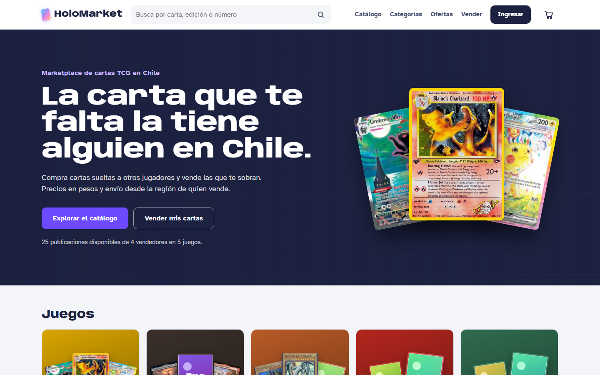
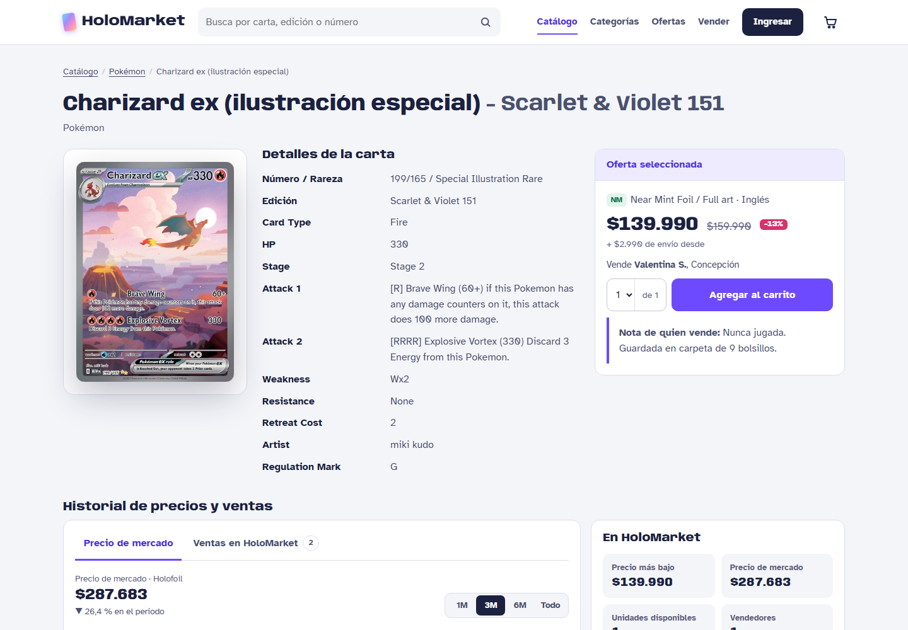
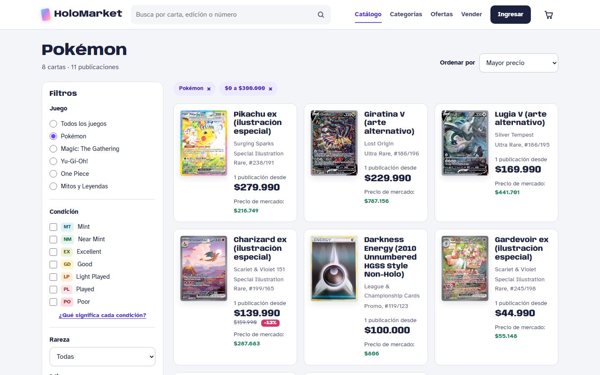
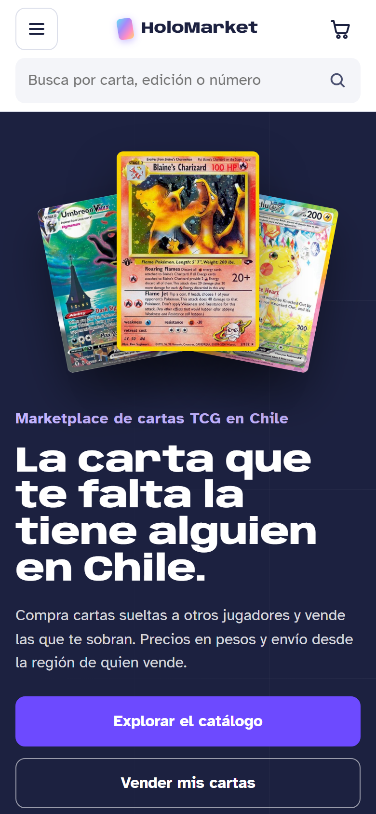
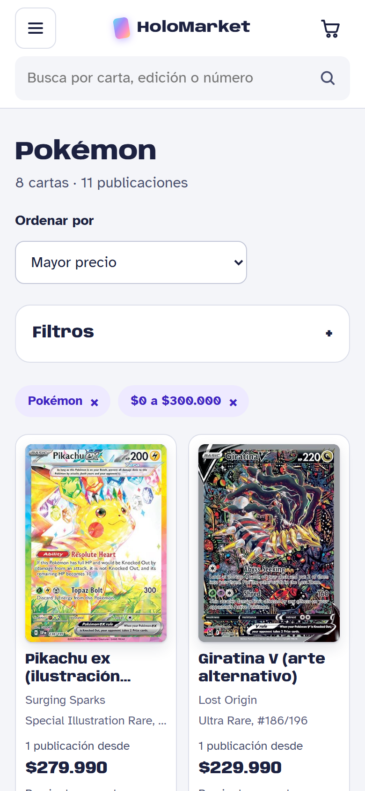
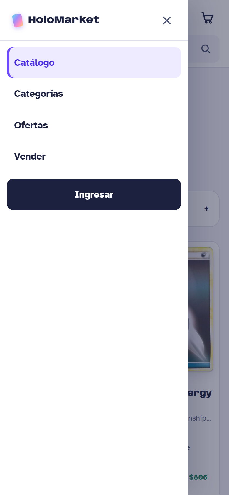

<div align="center">

# HoloMarket

**Marketplace chileno de cartas TCG sueltas: Pokémon, Magic, Yu-Gi-Oh!, One Piece y Mitos y Leyendas.**

[](https://github.com/nbralla/holomarket-react/actions/workflows/ci.yml)


**Sitio en la nube:** https://holomarket.3-218-125-149.sslip.io

DSY1104 Desarrollo FullStack II · Duoc UC · Evaluación Parcial 3
Nicolas Bralla y Sergio Melillan

</div>

---

## Contenido

1. [Qué es HoloMarket](#qué-es-holomarket)
2. [Capturas](#capturas)
3. [Funcionalidades](#funcionalidades)
4. [Arquitectura y tecnologías](#arquitectura-y-tecnologías)
5. [Estructura del repositorio](#estructura-del-repositorio)
6. [Ejecutar en tu PC](#ejecutar-en-tu-pc)
7. [Cuentas y datos de prueba](#cuentas-y-datos-de-prueba)
8. [Pruebas](#pruebas)
9. [Seguridad](#seguridad)
10. [Despliegue en AWS](#despliegue-en-aws)
11. [Documentación](#documentación)
12. [Entrega](#entrega)

## Qué es HoloMarket

Un marketplace donde personas de todo Chile compran y venden cartas coleccionables sueltas, al estilo
de TCGplayer. Si varias personas venden la misma carta, el catálogo la muestra una sola vez
("3 publicaciones desde $4.490") con el precio de mercado como referencia, y en la página de la carta
se comparan todas las ofertas por precio, condición, idioma y envío.

Todo es real salvo el cobro: los usuarios, publicaciones, pedidos, stock y retiros viven en **MySQL**,
las reglas del negocio y los permisos los aplica el **backend Spring Boot**, y el front en **React**
consume su API REST con un token **JWT**. El pago es simulado (tarjetas de prueba).

## Capturas

| Inicio (PC) | Página de una carta (PC) |
|---|---|
|  |  |

| Catálogo (PC) |
|---|
|  |

| Inicio (celular) | Catálogo (celular) | Menú (celular) |
|---|---|---|
|  |  |  |

## Funcionalidades

### Visitante
- Catálogo con búsqueda en vivo, filtros por juego, condición, rareza, idioma y precio (se guardan en la URL) y orden.
- Categorías por juego con pestañas de rareza, y vista de **ofertas** con el descuento calculado.
- Página de cada carta: imagen y datos reales desde **API TCG**, todas las publicaciones de esa carta,
  **historial de precio de mercado** (TCGplayer) convertido a pesos con el **dólar del día**, e historial
  de ventas dentro de HoloMarket.
- Registro con validación de RUT (módulo 11), correo único y contraseña segura.

### Cliente (compra y vende)
- **Carrito multivendedor**: un pedido por vendedor, con envío según la región de cada uno.
- **Checkout** con despacho o retiro y pago simulado con tarjeta (validación Luhn) o transferencia;
  las tarjetas rechazadas llevan a una vista de pago rechazado sin tocar el stock.
- **Vender**: publicar con autocompletado desde API TCG o foto propia, precio de oferta opcional y vista previa.
- **Inventario**: precio y stock editables, pausar, eliminar y **historial de stock (kardex)** con el
  stock antes y después de cada movimiento.
- **Pedidos**: compras y ventas con seguimiento (pagado → enviado → entregado) y cancelación.
- **Retiros** de las ganancias liberadas a una cuenta bancaria, con monto mínimo y anulación.

### Administrador
- Indicadores del negocio, moderación de publicaciones, bloqueo y reactivación de usuarios.
- Movimientos de stock de toda la tienda con filtros y **exportación a CSV**.
- Gestión de retiros (transferir o rechazar con motivo) y **auditoría** de acciones.
- Configuración: comisión, IVA, envíos, stock bajo, duración de la sesión, retiro mínimo y dólar de respaldo.

## Arquitectura y tecnologías

```
Navegador ──HTTPS──► Caddy (EC2) ──► /api/*  → Spring Boot (api) → MySQL
                                 └─► resto   → React compilado en Amazon S3
```

| Capa | Tecnologías |
|---|---|
| **Frontend** ([`frontend/`](frontend)) | React 19, TypeScript, Vite 7, React Router 7, Bootstrap 5.3, Context API y hooks propios |
| **Backend** ([`backend/`](backend)) | Spring Boot 3.5, Java 21, Spring Data JPA / Hibernate, Spring Security con JWT, BCrypt, Bean Validation, Swagger (springdoc) |
| **Base de datos** | MySQL 8.4 en Docker (10 tablas: usuarios, publicaciones, pedidos, ítems, historial, retiros, movimientos, actividad, configuración...) |
| **Infraestructura** | Docker Compose, Caddy 2.8 (HTTPS con Let's Encrypt), AWS EC2 t3.small + IP elástica, Amazon S3 (sitio estático) |
| **Calidad** | ESLint, TypeScript estricto, Vitest, Karma + Jasmine, GitHub Actions |
| **Servicios externos** | [API TCG](https://apitcg.com) (imágenes y precios, a través del backend), [mindicador.cl](https://mindicador.cl) y [open.er-api.com](https://open.er-api.com) (dólar) |

El backend sigue la estructura del ejemplo del curso: `controller → service → repository → entity`,
más `dto`, `security`, `config` y `exception`. La explicación completa (capas, flujo de una compra,
qué ve cada rol y decisiones) está en [docs/ARQUITECTURA.md](docs/ARQUITECTURA.md).

## Estructura del repositorio

```
holomarket-react/
├── .github/workflows/ci.yml     Integración continua: lint, tipos, pruebas, build y Docker en cada push
├── backend/                     API REST (Spring Boot + MySQL)        → backend/README.md
│   ├── src/main/java/cl/duoc/holomarket/
│   │   ├── controller/          Endpoints REST (auth, estado, publicaciones, pedidos, retiros, admin, proxy TCG)
│   │   ├── service/             Reglas del negocio en transacciones
│   │   ├── repository/          Spring Data JPA (incluye SELECT ... FOR UPDATE)
│   │   ├── entity/              Tablas de MySQL
│   │   ├── dto/                 JSON de entrada (con validaciones) y de salida
│   │   ├── security/            JWT, filtro de autenticación y límite de intentos de login
│   │   ├── config/              Spring Security, CORS, Swagger y carga de la demo
│   │   └── exception/           Errores en JSON uniforme
│   ├── src/main/resources/      application.properties y datos-demo.json
│   ├── pruebas/ataque.py        37 pruebas de seguridad y casos extremos
│   ├── Dockerfile               Imagen multietapa, corre como usuario sin privilegios
│   ├── docker-compose.yml       MySQL para desarrollo (puerto 3308)
│   ├── docker-compose.prod.yml  Producción: mysql + api + caddy
│   ├── Caddyfile                HTTPS, enrutamiento /api ↔ S3 y cabeceras de seguridad
│   └── .env.example / .env.prod.example   Plantillas de variables (los .env reales no se suben)
├── frontend/                    Sitio en React                        → frontend/README.md
│   ├── src/
│   │   ├── pages/               Una página por ruta (Catalogo, Detalle, Carrito, Vender, admin/...)
│   │   ├── components/          Componentes reutilizables (Cabecera, Carta, Tabla, Campo...) + *.spec.tsx
│   │   ├── context/ hooks/      Estado global (Context API) y hooks propios
│   │   ├── services/            Cliente de la API REST, API TCG, dólar, sesión y CSV
│   │   ├── logica/ utils/       Cálculos para mostrar y validaciones + *.test.ts
│   │   └── index.css            Estilos y diseño responsivo
│   ├── karma.conf.cjs           Pruebas de componentes en Chrome
│   └── vite.config.ts           Build, proxy de desarrollo y Vitest
├── docs/
│   ├── ARQUITECTURA.md          Cómo está armado y por qué
│   ├── capturas/                Imágenes de este README
│   └── index.html               GitHub Pages: redirige al sitio en la nube
├── DESPLIEGUE_AWS.md            Paso a paso del despliegue en AWS Learner Lab
└── URL_PROYECTO.txt             URL del proyecto en la nube (entregable)
```

## Ejecutar en tu PC

**Requisitos:** Docker Desktop, Java 21 (o IntelliJ IDEA), Node.js 20.19+ y Git.

```bash
git clone https://github.com/nbralla/holomarket-react.git
cd holomarket-react

# 1. Base de datos: MySQL en localhost:3308
cd backend
docker compose up -d

# 2. Backend: API en http://localhost:8080/api  (o ejecutar HolomarketApplication en IntelliJ)
mvn spring-boot:run

# 3. Frontend, en otra terminal: http://localhost:5173
cd frontend
npm install
npm run dev
```

- En el primer arranque el backend crea las tablas y carga la demo (`datos-demo.json`).
- En desarrollo, Vite reenvía `/api` al backend, así que no hay problemas de CORS.
- Swagger (documentación interactiva de la API): http://localhost:8080/swagger-ui.html
- Imágenes de cartas (opcional): copia `frontend/.env.example` como `.env.local` y agrega tu `APITCG_KEY`.
  Sin clave, las cartas se dibujan con CSS y todo lo demás funciona igual.
- ¿Sin Maven instalado? El [README del backend](backend/README.md#2-ejecutar-el-backend) muestra cómo correrlo con Docker.

## Cuentas y datos de prueba

Estas contraseñas son **solo de desarrollo**. En la nube se reemplazan por `ADMIN_PASSWORD` y
`DEMO_USER_PASSWORD` de `.env.prod`, que no se publican.

| Rol | Correo | Contraseña | Qué muestra |
|---|---|---|---|
| Administrador | admin@holomarket.cl | Admin1234 | Indicadores, moderación, usuarios, CSV, retiros y configuración |
| Cliente | camila@demo.cl | Demo1234 | Compradora con pedidos en curso |
| Cliente | diego@demo.cl | Demo1234 | Vendedor con ventas por enviar y saldo para retirar |
| Cliente | valentina@demo.cl | Demo1234 | Compra y vende; sirve para probar el bloqueo |

| Dato de prueba | Valor | Resultado |
|---|---|---|
| Tarjeta aprobada | `4111 1111 1111 1111`, vencimiento futuro, código `123` | Compra confirmada |
| Tarjeta rechazada | `4000 0000 0000 0002` | 402: el banco no autoriza |
| Tarjeta sin fondos | `4000 0000 0000 9995` | 402: sin fondos o cupo |
| RUT para registrarse | `21.456.789-K` | RUT válido |

Para volver a los datos iniciales: **Administración › Configuración › Restablecer datos de demostración**.
El [README del frontend](frontend/README.md#guion-de-demostración-5-a-7-minutos) tiene un guion de demostración de 5 a 7 minutos.

## Pruebas

| Qué | Dónde | Comando | Cobertura |
|---|---|---|---|
| Componentes React (82 pruebas) | `frontend/src/**/*.spec.tsx` | `npm run test:componentes` | Renderizado, props, estado, eventos y API simulada (Karma + Jasmine en Chrome) |
| Lógica y cliente de la API (40 pruebas) | `frontend/src/**/*.test.ts` | `npm run test:logica` | Validaciones, catálogo, carrito, saldo, dólar, errores 400/402 y sin red (Vitest) |
| Seguridad y casos extremos (37 pruebas) | `backend/pruebas/ataque.py` | `python pruebas/ataque.py` | Permisos entre usuarios, precios manipulados, concurrencia, validaciones, usuario bloqueado |
| Calidad del código | `frontend/` | `npm run lint` y `npm run build` | ESLint y TypeScript estricto |
| Integración continua | `.github/workflows/ci.yml` | Automática en cada push | Todo lo anterior del front, compilación del backend e imagen Docker |

`npm test` (en `frontend/`) ejecuta las 122 pruebas del front. El script de seguridad se ejecuta solo
contra el backend **local**, porque restablece los datos de demostración.

## Seguridad

| Riesgo | Cómo se cubre |
|---|---|
| Contraseñas | BCrypt en el servidor; nunca viajan de vuelta al navegador |
| Fuerza bruta en el login | 3 intentos fallidos bloquean ese correo 30 segundos (429) |
| Saltarse permisos desde el navegador | Cada endpoint exige token y rol; el usuario sale del token, no del cuerpo de la petición |
| Precios o cantidades manipulados | El servidor usa el precio guardado en la base y valida cantidades (1 a 999) |
| Doble venta del último stock | Transacción con `SELECT ... FOR UPDATE`: de 4 compras simultáneas solo pasa 1 |
| Datos de otros usuarios | `GET /api/estado` filtra por rol: un cliente no ve correos, RUT ni pedidos ajenos |
| Usuario bloqueado con sesión abierta | El filtro JWT revisa su estado en cada petición |
| Tráfico interceptado | HTTPS con Let's Encrypt y `Strict-Transport-Security` |
| Scripts inyectados, clickjacking | `Content-Security-Policy`, `X-Frame-Options: DENY`, `nosniff`; React escapa el texto |
| Claves en el código | `.env*` en `.gitignore`; la clave de API TCG solo vive en el servidor y el proxy acepta solo 3 consultas |
| Base de datos expuesta | MySQL sin puertos hacia afuera; solo la ve el contenedor del backend |

Detalle y pendientes en [docs/ARQUITECTURA.md › Seguridad](docs/ARQUITECTURA.md#5-seguridad).

## Despliegue en AWS

| Pieza | Servicio |
|---|---|
| Front (archivos de `frontend/dist/`) | Amazon S3 con hosting de sitio estático |
| HTTPS y enrutamiento | Caddy en la EC2 (CloudFront está bloqueado en el Learner Lab) |
| Backend + MySQL | EC2 t3.small con Docker Compose e IP elástica |

El sitio funciona mientras el **Learner Lab** esté iniciado (sesiones de unas 4 horas). Al iniciar una
sesión nueva, la EC2 y los contenedores arrancan solos.

Guía completa, paso a paso y con solución de problemas: [DESPLIEGUE_AWS.md](DESPLIEGUE_AWS.md).

## Documentación

| Documento | Contenido |
|---|---|
| [backend/README.md](backend/README.md) | Cómo ejecutar el backend, Swagger, **tabla de todos los endpoints**, variables de entorno y producción |
| [frontend/README.md](frontend/README.md) | Scripts, rutas, diseño responsivo, API TCG, requisitos implementados y detalle de las pruebas |
| [docs/ARQUITECTURA.md](docs/ARQUITECTURA.md) | Capas, flujo de una compra, qué ve cada rol, conceptos de React y seguridad |
| [DESPLIEGUE_AWS.md](DESPLIEGUE_AWS.md) | Despliegue en AWS Learner Lab, de cero a HTTPS |

## Entrega

| Entregable | Dónde |
|---|---|
| Código backend | [`backend/`](backend) |
| Código frontend | [`frontend/`](frontend) |
| Base de datos | MySQL 8.4: entidades en `backend/.../entity`, datos iniciales en `datos-demo.json`, contenedor en los `docker-compose` |
| Docker | `backend/Dockerfile`, `docker-compose.yml` (desarrollo) y `docker-compose.prod.yml` (producción) |
| Despliegue en AWS | [DESPLIEGUE_AWS.md](DESPLIEGUE_AWS.md) y el sitio en línea |
| URL del proyecto en la nube | [URL_PROYECTO.txt](URL_PROYECTO.txt) |

---

<sub>Proyecto académico para Duoc UC. Pokémon, Magic: The Gathering, Yu-Gi-Oh!, One Piece y Mitos y
Leyendas son marcas de sus respectivos dueños; las imágenes de cartas provienen de API TCG.</sub>
